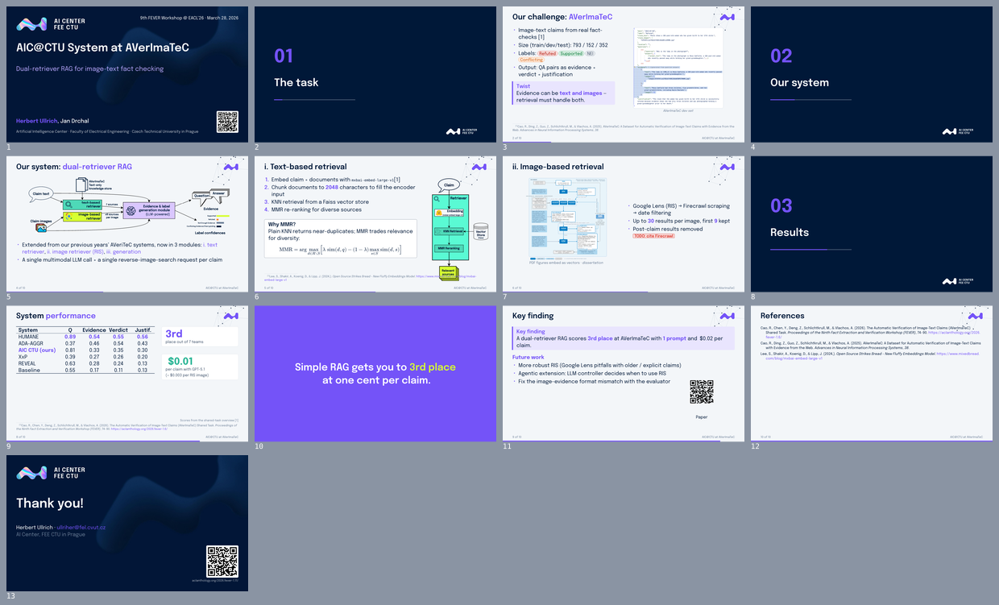

# typst-template-aic

[](https://github.com/heruberuto/typst-template-aic/actions/workflows/build.yml)
[](https://heruberuto.github.io/typst-template-aic/)

A slide template for scientific talks in [Typst](https://typst.app) + [Touying](https://touying-typ.github.io), styled after the **AI Center FEE CTU** deck: a navy title slide, light content slides, a purple accent, and the Epilogue font. It's built for working with an LLM: the agent drafts the deck, renders it to PNG to check its own layout, and gets a hard error when a slide overflows.



## Quick start

Requirements: `typst` ≥ 0.15 (`brew install typst` / `mise use typst`). Packages download on the first compile.

```bash
scripts/new.sh 2026-11-venue-topic      # new talk from talks/_template
scripts/watch.sh 2026-11-venue-topic    # live PDF in build/
scripts/build.sh                        # all talks → build/<talk>.pdf + build/<talk>-handout.pdf
scripts/png.sh <talk>                   # PNG per slide + contact sheet (build/png/<talk>/sheet.png)
scripts/check.sh <talk>                 # overflow + #todo report, run before sending
```

In VS Code, install **Tinymist** (recommended in `.vscode/`) and run *Typst Preview* on `slides.typ` for a live preview with click-to-source. The workspace settings point Tinymist at the repo root and the bundled fonts, and turn on paste and drag-and-drop for images.

The **handout** PDF collapses all `#pause` animations, so that's the one to email or put on the conference page. CI builds every talk on push and publishes the PDFs to GitHub Pages.

## Writing slides

```typst
#import "/aic.typ": *
#show: aic-theme.with(
  venue: [FEVER \@ EACL 2026],
  config-info(title: [...], author: [...], date: datetime.today()),
)
#title-slide(qr: "https://aclanthology.org/...")

= Method                                   // numbered section slide

== Our system: #hl[dual-retriever RAG]     // content slide, purple key term
#cols(columns: (1fr, 1fr))[
  - Retrieval @cao-etal-2025-averimatec    // citation → footnote on this slide
  #pause
  #takeaway[Simple beats complex.]
][
  #screenshot(image("figures/ui.png", height: 70%), source: [arxiv.org])
]
```

See [`talks/2026-03-fever-averimatec/slides.typ`](talks/2026-03-fever-averimatec/slides.typ) for a full example and [`CLAUDE.md`](CLAUDE.md) for the complete helper reference (`fig`, `screenshot`, `bleed-right`, `stat`, `pill`, `best`, `source`, `at`, `qr`, `todo`, …).

## Working with an agent

`CLAUDE.md` (also available as `AGENTS.md`) teaches the agent the workflow: draft → `check.sh` → `png.sh` → look at the contact sheet → fix → repeat. It also lists the Typst pitfalls LLMs hit most often (`\@`, `\$`, no LaTeX macros) and the deck style rules. A typical prompt:

> Make a 12-minute talk from ../my-paper (LaTeX). Reuse its figures and bib. New talk `2026-11-aaai-xyz`.

## Licenses

- Code (theme, scripts): MIT, see `LICENSE`.
- Epilogue font: SIL Open Font License, see `fonts/epilogue/OFL.txt`.
- AIC logos and the title background in `assets/` belong to the Artificial Intelligence Center, FEE CTU. They're included for use by AIC members and aren't covered by the MIT license.
